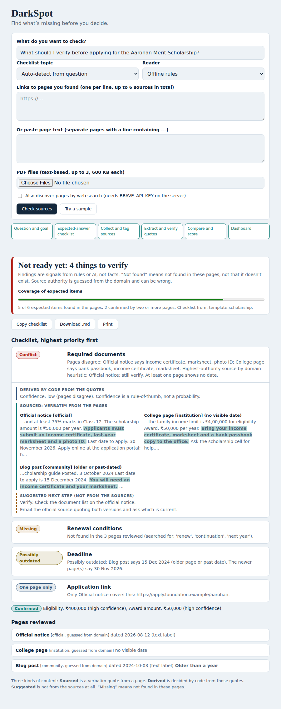

# DarkSpot: find what your sources leave out

Enter a question and add pages (links, pasted text, PDFs). DarkSpot streams its progress live, then lists conflicts, gaps and outdated details
as a checklist. Every finding shows the exact quote behind it, and the dashboard keeps three kinds of content apart:
**Sourced** (verbatim quote), **Derived** (decided by code), **Suggested** (not from the sources).

## Run (Python 3.10+, no installs needed for the core)
    python -m darkspot          # open http://127.0.0.1:8000, press "Try a sample"
    python -m unittest tests.test_core -v
Optional: `pip install pypdf` (PDF upload), `pip install anthropic` (live reader), see `.env.example`.

## What was verified, and what was not
Verified in the build sandbox: 18 tests (verbatim quotes, negation, date formats, topic checklists, validation of model output, SSRF blocks,
PDF text extraction, real streaming over HTTP), a real server process, and a headless-browser run with no console or CSP errors.
**Written to the documented API format but NOT run (no network or keys in the sandbox):** Claude live reader and checklist (`llm.py`),
Brave search discovery (`net.discover`), and fetching real external URLs. Test them with your keys before relying on them.

## Honest limits
Findings are signals, not facts. "Missing" means not found in the pages reviewed. Offline mode has three built-in topic checklists
(scholarship, visa, general); other topics need the Claude checklist. Source authority is guessed from the domain and can be wrong.
Ambiguous dates such as 03/04/2026 are not guessed. Rule reader takes the first matching sentence per page. Pages that need JavaScript,
scanned PDFs and logins are not read (paste text instead). Sample pages are fictional. See docs/ARCHITECTURE.md.
